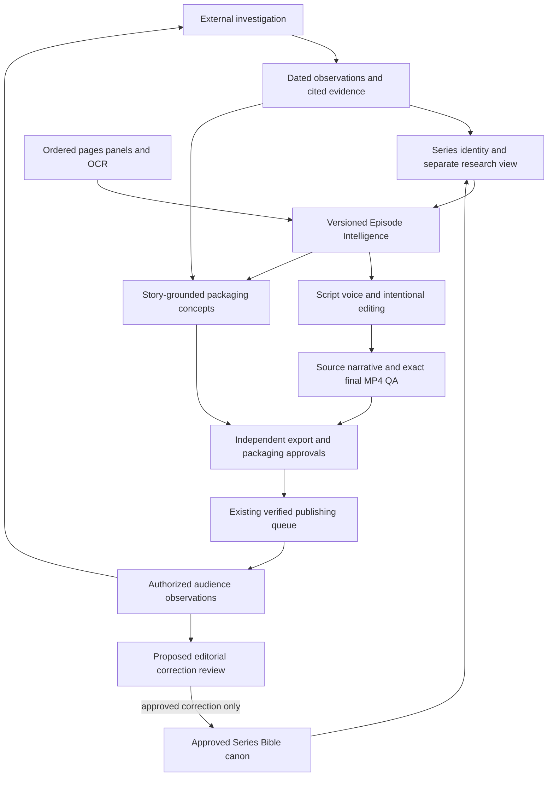

# Flamingo connected intelligence: implementation design and source assessment

October 18, 2026. This is an owner-requested design/source-feasibility checkpoint, not an implemented Research Investigator or a production migration. Read with [the vision](FLAMINGO_STUDIO_VISION.md) and [the eight-milestone backlog](FLAMINGO_DEVELOPMENT_ROADMAP.md). Finish ongoing approved offline work before starting dependent consumers. M1/M2 and the M3 review checkpoints remain intact.

## Reuse, repair, build

| Area | Existing infrastructure to reuse | Repair or extend | Genuinely needs building |
|---|---|---|---|
| Series research | `series_research.py` preserves grounded sources, claims, queries, disputes and rejected characters; `research_service.py` bridges watchlist mirrors and Bible, preserving owner edits | Watchlist/URL-centered entry points cannot discover an unknown series independently; source tiers alone do not verify an individual story claim | Cross-source investigations and reviewed Series Intelligence projections, including candidates before watchlist membership |
| Series identity/continuity | `series_bible.py` character/world context; `series_pack.py` aliases, Korean/English titles, playlist, branding and owner fields; tracker/mirror mapping | Slug/case-based alias aggregation is not verified cross-language entity resolution; distinguish character names, adaptations and ambiguous abbreviations; reconcile Bible/local copies/pack revisions | Stable identity links and conflict review across existing stores, without a second canonical database |
| Episode production | Ordered source files/descriptions; typed OCR/speaker basis; M2 original line IDs; anchored script and beat/shot/segment provenance; Series Bible injected into vision/writing/revisions | Current artifacts describe different parts of the episode; model text is fallible; M3 linkage does not prove semantic completeness | A versioned Episode Intelligence view with evidence-bound events, scene transitions, character/location references, uncertainty and corrections shared by consumers |
| Cache/dependencies | M3 image hashes, generation manifests, staged source preservation and rerun archives; content-keyed global TTS cache | Current whole-artifact identities are conservative and do not satisfy field-level selective invalidation; reviewed legacy adoption remains open | Dependency index and previews of affected results; retain valid media and operator decisions |
| Demand discovery | `demand_research.py` searches public YouTube recaps for tracker titles; `yt_api.py` offers bounded client/fake transport; SEO has competitor research | Lifetime views/age is not recent velocity; small title-match sample cannot prove saturation; YouTube accounting needs current bucket/project verification | Outside-watchlist catalog/genre/topic discovery, historical observations, independent corroboration and evidence-led opportunity comparisons |
| Packaging | `seo.truth_card`, sourced `seo_research`, `series_hooks`, chapter SEO, thumbnail candidates/readability/series style and owner approvals | A source URL attached to a hook is not verified support for every clause; preserve existing locked series-title contract while proposing episode concepts; no observed-CTR claim from heuristic scores | Distinct event/theme-supported title/thumbnail concept sets, opening-promise review and experiment-to-performance linkage |
| UI/publishing/learning | Home, Library series rows/Bible editor, Chapter Board/Issues/Video, packaging controls, Queue/Activity/Settings; exact-export diagnostic readiness | Connect current surfaces and make uncertainty visible; intended channel mapping remains unresolved; current catalog is not a demand signal | Research Desk and Audience Desk capabilities within existing navigation; shared IDs/evidence deep links and independent promotional asset reviews |

These are code-grounded findings from the current feature-branch checkout. Existing tests establish the recorded behavior in the roadmap; this document does not claim that real story quality, external integrations or production operation have been verified.

## Confirmed identity repair prerequisite

An isolated offline reproduction redirected Bible storage to a scratch fixture directory. Two unrelated synthetic Korean titles both normalize to `unknown-series` in the current `series_bible.slugify`; `load_series_bible` then matches that empty-equivalent alias against a built-in entry and returns an unrelated seeded Bible. No live Bible or project was changed. This is a confirmed lookup defect, not proof that production episodes experienced it.

Before consuming the proposed shared records, add Unicode-aware identity/verified-alias regression coverage, avoid fuzzy/empty alias matches, and distinguish lookup normalization from filesystem IDs. Keep existing IDs/files stable: fixing a resolver does not authorize rewriting historical canon or re-keying data. A read-only projection must also avoid `load_series_bible`'s implicit seeding/directory creation. The repair/prototype should be its own small PR with known-alias, unrelated Korean/Latin titles, ambiguous prefixes, missing identity and no-write fixtures.

## Proposed connected information flow

This target architecture is not an implemented service diagram. Evidence support/review state travels with every reference.

## Series Intelligence contract

Extend the existing Bible and series pack. Use the existing stable series ID where sound, and an explicit stable ID for pre-ingest discoveries; titles/slugs are editable lookup keys, not identity. A reviewed identity mapping joins watchlist IDs, provider IDs, publisher URLs, Bible keys and pack keys. No bulk re-keying or second source of canon is authorized by this design.

The connected view must expose:

- Canonical title; English alternatives, Korean/original-language titles, romanizations and abbreviations, each with language, supporting evidence and verification state. An unresolved alias cannot silently merge two series. Novel/webtoon/anime adaptations are related works, not automatically aliases of one object.
- Genre, themes, premise, characters, identities, relationships, recurring terms, pronunciation and world/continuity facts from the Bible; chapter applicability/spoiler bounds and approved corrections.
- Official publisher/creator IDs and URLs, publication/language/region, releases, returns/hiatuses/adaptations and observation dates. Missing official metadata remains unknown.
- Separate external-interest/competitor observations and audience hypotheses, with evidence IDs and disagreements. A reader theory is research evidence about discussion, not a factual plot/character field.
- Existing episodes, compilations, production revisions, export/publication history and approved recurring presentation/thumbnail DNA. Link existing project and publication ledgers rather than create competing histories.

Each claim needs an ID, value, claim type (`source_observation`, `interpretation`, `market_observation`, `audience_hypothesis`, `approved_canon`), origin, source references, observation/review dates, uncertainty/disputes and superseded revision where relevant. These are proposed contract names, not a claim that the fields already exist. Source-domain reputation is evidence context, not proof of a claim. Existing owner edits remain authoritative; newly discovered research enters a review lane. No automatic conversion of Reddit/competitor text into canon.

## Episode Intelligence contract

Build a versioned view over existing project evidence; do not replace descriptions, anchored narration, the storyboard or render manifests. It must identify series, chapter/episode, provider/source edition, source revision and Bible revision. A compilation preserves ordered child episode IDs/revisions, chapter spans and timeline offsets; it must not collapse several chapter identities into one.

The view contains original page ordering/URLs and local image hashes; panel IDs, image references and source-page/crop mapping; ordered OCR lines/captions/dialogue/SFX; speaker identity and tail/context/guess basis; character/location references; scene boundaries/transitions; and evidence-bound events, reactions, intentions, consequences, reveals, stakes and hooks. Interpretations such as intent or emotion remain labeled as inference when not directly supported. Uncertain speakers, missing pages, unreadable text, contradictory evidence, omissions and editorial corrections stay visible.

Events and claims reference exact source lines/panels and approved canonical context. Keep original evidence and append correction/review records instead of overwriting history. A source reference means evidence was available; it never automatically means an event was narrated accurately. M3.5 remains blocked on reviewed labeled semantic-coverage examples and creative omission/paraphrase decisions.

| Consumer | Required connection |
|---|---|
| Initial script and revisions | Same episode/Bible revision and approved corrections; claim/source references per narration sentence |
| Dialogue/factual QA | Coverage candidates, supported paraphrases, attribution, uncertainty and deliberate omissions; no clean verdict when evidence/review is incomplete |
| TTS and pronunciation | Approved names/terms, speakable text, pronunciation revision, voice and timing intent per beat |
| Matching and editing | Sentence meaning/claimed event, source panels, scene purpose, reactions/reveals, crop anchors and editable timing plan |
| Final QA | Exact export identity plus episode/script/audio/shot revisions, timestamp mapping and unresolved editorial findings |
| SEO and thumbnail concepts | Approved episode events or verified series themes; each promise clause and candidate image traceable to evidence |
| Shorts/Reels/community assets | Parent episode/export revision, own story objective, selected evidence, platform-specific draft/QA/approval |
| Continuity and audience learning | Approved corrections and observed responses linked to episode/series; feedback proposes revisions, never silently rewrites canon |

## Selective invalidation and editorial preservation

The following is the target behavior; M3 currently uses more conservative whole-artifact checks. New dependency work must be opt-in until regression-tested against legacy artifacts. Never silently regenerate paid artifacts or clear operator edits.

| Changed input | Results to review/recompute | Work to preserve when its effective inputs are unchanged |
|---|---|---|
| External market observation | Opportunity comparison, programming priorities, market-informed packaging hypotheses | Source/OCR, approved canon, script, voice, rendered export and its technical QA |
| Canonical/alternative title | Identity display, metadata; spoken opening only if it uses that title | Unrelated scenes, voice beats and images; aliases are not permission to rename IDs |
| Source pixels/OCR/speaker correction | Affected descriptions/claims/scenes, dependent script/matches/crops and export QA | Unaffected source revisions, scenes and recorded beats; revoice only changed speakable content/pronunciation/voice |
| Script sentence edit | Affected coverage, beats, matching, timing/segments/clips and exact-export review | Unchanged content-keyed voice, unrelated shots and explicit operator corrections |
| Timing/crop/edit plan | Affected clips, export timestamp map and final-file QA/review identity | Script/OCR/Bible and unchanged voice content |
| Title/thumbnail concept or approval | Packaging review/experiment and publishing-preparation identity | Final MP4 bytes and technical QA if the video did not change |
| Audience feedback or proposed theory | Research/creative hypotheses and draft correction review | Canon and approved artifacts until a correction is accepted |

Track effective dependencies/revisions per output and preview what a change affects before applying it. Preserve originals and approvals as history; an approval may become stale for a new artifact without deleting the approved old export. Selective invalidation must not weaken M1 exact-file checks or enable publication enforcement prematurely.

## Detailed implementation sequence

All phases below are planned, not implemented by this document. Safe M3 hardening is now separately reviewable in PR #4; its selected combined suite passes 104 tests. Legacy adoption, semantic verdicts and real-video calibration remain incomplete; none is silently satisfied by the architecture plan.

| Phase / priority | Dependencies and proposed change | Reviewable delivery and offline acceptance |
|---|---|---|
| P0 / critical | Current M3.1–M3.4, before dependent work | Cache/source/linkage hardening with failure/cap/partial-promotion regressions; Ready for Review. M1/M2 stay reviewable separately; deployment and publication enforcement remain unapproved. |
| P1 / high, next independent task | Existing Bible/pack/project contracts; no owner-data migration | Add a small **read-only projection/schema prototype** (proposed `review_ui/intelligence.py`) over existing IDs/fields. Return canon/research/episode namespaces and uncertainty; validate synthetic fixtures. First cover/repair the confirmed Unicode/empty-alias lookup defect without re-keying data. Tests: known versus unrelated Korean/Latin aliases and ambiguous prefixes, related adaptations, missing IDs, unknown legacy review status, owner precedence, no implicit seeding/source writes or network calls. No claim that imported legacy records are verified. |
| P2 / high | P1 identity contract; current OCR/anchored provenance | Build Episode Intelligence from descriptions, page/crop order, source lines and structured script/segments; reference source/Bible revisions. Reuse source-review/coverage and QA IDs. Add scene/event/intent **candidate** schema; do not make a new paid extractor or infer verified events from generic descriptions. Test source-line identity/order, uncertain speakers, conflicting facts, missing evidence, compilation child identities/offsets and correction history. |
| P3 / high | P1/P2 revision contracts and current M3 hashes | Prototype effective dependency keys and a dry-run affected-output preview. Adapt script/voice/edit/QA/metadata consumers gradually behind explicit opt-in; retain the old path with unknown-status reporting. Test the mutation matrix above, bounded partial failures, independent package/export approval identities, unchanged voice reuse and operator edits. Historical adoption and semantic approval are still separate owner/evidence tasks. |
| P4 / high | P1 identity; evidence schema and approved data-retention/access rules | Implement **file/fixture evidence import first** in existing research services: append observations and source payload references, resolve verified aliases and deduplicate the underlying source. Add bounded query-plan/draft-opportunity records without executing live adapters. Test timestamps/units/query scope, stale/missing sources, conflicts, duplicate press coverage and rejected theory-to-canon writes. |
| P5 / medium, approval required before live integration | P4; owner approves specific source integration, cost, access and quotas | Add one justified adapter at a time: official catalogs/news, public YouTube comparables, permitted community/search-interest sources, then optional authorized vidIQ. Reuse `yt_api.Client` fake transport/research source rules; repair current quota accounting only after actual project allocation verification. Review adapter identity/rate/price/error/retention contracts and fake failures before a live trial. No blanket research loop or account reconnect. |
| P6 / medium | P2 story claims + P4 market evidence; P5 only for approved live input | Opportunity comparisons explain why now versus alternatives, not a popularity score. Packaging receives separate story/market inputs and returns distinct supported promises, candidate art, opening fulfillment and metadata. Reuse `seo.truth_card`, sourced hooks, chapter metadata and thumbnail readability. Test unsupported hooks, wrong episode image, independent approvals, locked-series-hook preservation and editorial rubric versus observed-performance labels. |
| P7 / medium | P1–P4 stable contracts; P6 drafts | Extend current Home/Library/Chapter/Issues/Video/Queue/Activity views with evidence deep links and uncertainty; add audience-feedback/experiment projections using fixtures. Verify browser → API → stored fixture → response, no live-data writes. Private analytics/publishing/recurring jobs await specific authorization; coordinated promotional assets retain independent review/QA. |

P1/P2 can be tested without deciding whether historical caches should be adopted or whether a paraphrase is creatively complete. They must report those states as unknown. They do not authorize dependent live research or replace current model prompts. All wiring follows a contract-first fixture checkpoint and separate PRs; no branch is merged/deployed automatically.

### Storage and API proposal

Use the existing private `projects/` hierarchy and existing series IDs. Extend `_series_packs/<series_id>.json` with versioned identity/research **references**, retain `_series_bibles/` as canonical continuity, and keep existing title/alias arrays readable by old consumers. Store new permitted investigation evidence beside the corresponding pack (for example `_series_packs/<series_id>/investigations/<id>/`); this is evidence history, not another canon database. A pre-watchlist candidate can have a pack/identity without a scraper mirror or chapter project.

An `episode_intelligence.json` sidecar in an existing chapter project is a reproducible projection/cache over source and canon revisions, not a replacement for raw evidence or an automatically approved story. Its manifest lists field/claim dependencies and review states. Compilations reference existing child records and timing components. Keep raw sources, approved edits and source snapshots separate from this derived view; no bulk migration or inferred historical approval.

Start with pure schema/projection functions and fixture import. A later read-only `GET /api/series/intelligence` and project-scoped `GET /api/episode/intelligence` can expose them; these are proposed endpoints, not currently shipped ones. Writes must use existing scoped update/locking/atomic-write conventions and append revision/evidence IDs; add concurrency/lost-update tests before introducing persisted intelligence references. The current `series_pack.save` preservation rules must explicitly retain new owner-approved fields rather than assuming any stale writer can replace the pack.

Each consumer request names the accepted episode/canon revision and source claim IDs. Each draft output records consumed field keys/hashes, model/prompt/version where relevant, unsupported claims/uncertainties and approval state. A missing/stale revision returns an explicit unavailable/review state; it does not silently fall back to a fresh model guess. New market evidence never lives inside the narrator's canonical context and cannot trigger a narration regeneration merely by being collected.

### Remaining evidence/owner decisions

- **M3.5 semantic coverage:** supply/review labeled source/script cases covering important omitted dialogue/events, supported paraphrases, silent/reaction beats, ambiguity and acceptable recap compression. Until evaluated, no completeness percentage or semantic pass/block gate.
- **M3.6 legacy adoption:** review representative historical caches and choose what owner attestation may establish about current outputs while historical generation inputs remain unknown. No automatic adoption, forced paid rewrite or manufactured old identity.
- **M1 calibration:** review approved-good and defective real final MP4/source bundles, thresholds/intentional pauses and exact-export approval behavior before explicitly enabling any new production blocker. Existing generated-signal tests cannot replace this.
- **Live research:** approve specific source adapters, access, credit limits/quotas and retention; verify intended channel IDs before private analytics or publication preparation. This checkpoint makes none of those account/destination decisions.

## External Research Investigator and opportunity contract

An investigation can start from a genre/theme, publisher new-release list, adaptation/return announcement, audience request or unknown series, not only the owner's uploads/watchlist. Follow an allowlisted, bounded collection plan: public official material and permitted data access, source-specific freshness and quotas, explicit costs/permissions, no scheduled job or paid adapter enabled by this checkpoint. Research is proactive within a requested/authorized investigation; recurring autonomous monitoring requires a separately requested schedule.

Persist evidence before synthesis in the existing private project/series storage conventions. Each observation records evidence ID, canonical/candidate series or topic ID, original URL/provider, query/discovery route, retrieved/observed UTC time, publication/event time where known, language/geography/format/window, metric name/value/unit, method/source payload reference or permitted excerpt/hash, access status and uncertainty. Preserve an auditable observation or permitted snapshot, not just an AI paragraph. Retention must honor provider restrictions and privacy; private channel/account/viewer data and source payloads do not belong in this public Git repository.

An opportunity record must name the candidate/topic and verified aliases; explain the audience and why it matters; cite supporting/conflicting evidence URLs and observation dates; label measured facts, provider estimates and inference; give any actually observed recent change and comparison window; identify comparable YouTube videos with publication age/format/current counts and collection dates; describe sampled competition and sampling limits; classify demand as broad/niche/emerging/uncertain with reasons; identify lawful chapter/source availability separately from catalog access; estimate production effort with a stated basis; list risks and missing evidence; and explain the choice against named alternative candidates. Unknown volumes/velocity/rights remain unknown. Never invent forecasts or a composite popularity number.

Publisher rank, Reddit discussion, YouTube views and Google search interest remain distinct metric families. Repeated articles quoting one press release are one underlying source, not independent corroboration. Contrast disagreements and thin samples. A publisher launch/adaptation notice is timing evidence, not proof that viewers want an English recap. Recommendations must work for a previously untracked series with zero uploads on the owner's channel.

## Source feasibility verified October 18, 2026

This assesses access/capability, not current market winners. No authenticated collection adapters, paid research or source chapters were run.

| Source | What it can support | Access and measurement limits |
|---|---|---|
| [WEBTOON rankings](https://www.webtoons.com/en/ranking) and [Originals schedule](https://www.webtoons.com/en/originals) | Official catalog/genre/discovery and release-day observations | Public pages verified; catalog coverage differs by locale. Rank/schedule is not YouTube demand or an automatic reuse license. No public bulk API entitlement established. |
| [Tapas Originals](https://tapas.io/landing-list/4), [Naver WEBTOON](https://comic.naver.com/webtoon), [Kakao Page](https://page.kakao.com/) | Publisher/title identity, language variants, release/catalog leads | Tapas returned a limited shell, Naver no extracted text, Kakao navigation only in this retrieval. Structured collection feasibility is unverified; do not manufacture rankings or bypass access controls. |
| [Kakao official newsroom](https://newsroom.kakaoent.com/) and [Korean announcements](https://www.kakaoent.com/pr/news) | Dated releases, adaptation announcements and event timing | Public announcements verified; publisher promotional performance claims remain attributed claims. [WEBTOON press page](https://about.webtoon.com/press-release) was not retrievable in this run; mark source unavailable rather than treating it as an empty news feed. |
| [YouTube search](https://developers.google.com/youtube/data/reference/rest/v3/search/list) and [API overview](https://developers.google.com/youtube/data/getting-started) | Discover public comparison videos/channels; join video statistics and repeat observations for interval change | Search results are not search-volume data. Current docs separate the search quota from other endpoints; existing `yt_api.COST`/single spent counter uses older assumptions. Confirm the actual project's allocation before repair or collection; no quota-console access attempted. |
| [Google Trends website data](https://support.google.com/trends/answer/4365533?hl=en) and [API alpha](https://developers.google.com/search/apis/trends) | Relative search-interest evidence with time/geography/search surface; manual permitted exports as a first adapter input | Website indices normalize per request. Alpha documentation describes consistent cross-request scaling but still not absolute query counts; access is application-limited and not verified for this owner. Do not assume API availability or combine incomparable series. |
| [Reddit access documentation](https://support.reddithelp.com/hc/en-us/articles/14945211791892-Developer-Platform-Accessing-Reddit-Data) | Permitted, deidentified discussion themes, requests and dated community observations | Official guidance requires use-case/access review and distinguishes commercial arrangements and research access. No approved collection access established here. Use permitted owner-supplied evidence first; no scraping workaround, mass export, automatic posting or assumption that public visibility grants API access. |
| vidIQ installed connector (capability/account check) | Exposed tools cover public search, keywords, outliers/trends, comparables and private authorized-channel analytics | Tool presence is not a repository integration, credit authorization or metric truth. One account-state call used 0 credits; intended Flamingo channel absent from authorized list. No public research/credit-consuming tools or private analytics called. No reconnect/account changes. |

## Named media applications and missing video

Only the text attachment is available. No video file/URL was supplied with it, so precise on-screen apps, versions, extensions or workflow claims cannot be assessed. The named applications were checked against their primary repositories:

- [Mangayomi](https://github.com/kodjodevf/mangayomi) is a reader/media client with source extensions and library features. The [extension repository used by this project](https://github.com/kodjodevf/mangayomi-extensions) is archived/read-only. Locally, `mangayomi.py` fetches/cache-lists an index and registers a generic provider over a fixed domain directory; it does not execute all upstream Dart/JavaScript scraper extensions. Its silent seeded fallback does not establish that a live catalog was fetched, that a source is maintained, or that material is lawful. Existing unverified TLS contexts must be repaired/tested before extension. Do not swap in an unreviewed fork or execute extensions automatically.
- [NewPipe](https://github.com/TeamNewPipe/NewPipe) is an Android media front end with search, channel/feed grouping, related-video and comment display. Those interaction patterns may inform research UI. It is not an authorized private-analytics or search-volume provider for this studio; no new streaming/download subsystem is needed.
- [Stremio's SDK](https://github.com/Stremio/stremio-addon-sdk) separates catalog/meta resources from streams and subtitles. Catalog/metadata separation may inform adapter design. No Stremio integration or stream/add-on installation is proposed; catalog access does not demonstrate market demand or permission to reuse media.

## Packaging and navigation integration

Keep market research, episode evidence and packaging strategy as distinct linked inputs. Prepare genuinely different title/thumbnail promises, each tied to an approved episode event or verified series theme. Evaluate clarity, specificity, audience fit, mobile readability, distinctiveness, relevant terms and whether the opening fulfills the promise. These are editorial rubrics, not predicted CTR. Retain accurate chapter/range, canonical/alternative title references, description, tags, justified hashtags and playlist association.

Current locked series hooks remain authoritative until the owner chooses a new concept. New concept sets are drafts and must not automatically retitle old chapters or weaken publishing review. Observed CTR/watch time/retention/returning viewers/test outcomes are separately labeled by sample/window and only used when intended-channel authorization exists.

| Desired workspace | Extend current surface |
|---|---|
| Research Desk | Home programming brief + Library investigation/evidence view; reuse demand/research services |
| Series Room | Library series detail/Bible, cast, aliases, release information, branding, research and episode history |
| Episode Production | Chapter Board/source/OCR/script/voice/storyboard plus the shared evidence view |
| Quality Director | Chapter Issues/Video with technical/editorial findings, timestamps, focused repairs and rechecks |
| Packaging Studio | Existing SEO/hook/thumbnail controls with evidence and distinct concept comparisons |
| Publishing Queue | Existing Queue and Video approval, exact export/destination verification/status/recovery |
| Audience Desk | Activity/Home briefing plus authorized performance, experiments, community requests and reply drafts |

Preserve current URLs/navigation and extend views before introducing pages. One approved episode may later produce coordinated promotional assets, each with its own evidence revision, preview, QA and approval. Audience learning returns to investigations and creative decisions without turning model guesses into canon or publishing automatically.
